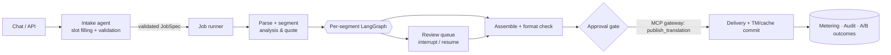
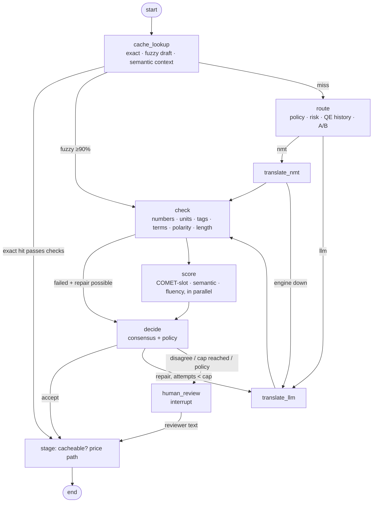

# Translation Agent Platform

An agentic **NMT + LLM translation platform** for regulated (life-sciences) content: conversational intake, a LangGraph
workflow per segment, safe tool access through an MCP gateway, multi-judge consensus scoring, tiered reuse (exact → fuzzy →
semantic), human-in-the-loop review, A/B experiments, cost metering and a tamper-evident audit trail.

It is the runnable implementation of the reference design in
[`docs/reference/Translation_Agent_Platform_Guide.html`](docs/reference/Translation_Agent_Platform_Guide.html).

> **Read this first: what is real and what is a stand-in**
>
> | Real and tested | Stand-in (clearly labelled, swap for production) |
> |---|---|
> | Orchestration (LangGraph graph, checkpoints, interrupt/resume, crash recovery), routing rules, deterministic checks, consensus logic, MCP gateway + approvals, tenant isolation, cache/TM/glossary versioning, outbox/event bus, audit chain, metering, A/B statistics, API, console | **`demo` backends**: offline engines and *scripted* scores that reproduce the guide's five scenarios so the platform runs with no keys. They are not translation or quality models. |
> | Adapters for **Anthropic** (LLM + LLM judges), **LibreTranslate** (NMT) and **Redis** cache, covered by unit tests against fakes | Not exercised against live services in this repository's CI. Do a first run with your own keys before relying on them. |
> | | **Heuristic evaluators** (`quality_backend=heuristic`) are a safety net, **not** COMET. The COMET-Kiwi / LaBSE adapters (`ml` extra) are written but untested here (heavy model downloads). Calibrate against human MQM ratings before trusting any threshold. |
> | | Cost figures use **illustrative prices**. The "~80% cheaper" claim from the guide is *not* reproduced: savings come out of your measured prices and reuse (the demo shows −5% on a small high-risk leaflet and +93% on a UI-strings file). |

## Quick start (no API keys)

```bash
python -m venv .venv && source .venv/bin/activate
pip install -e ".[dev]"

tap demo      # end-to-end: intake-less job, repair, human pause/resume, approval, delivery, savings, audit check
make check    # ruff + mypy + 200+ tests (~1 min)
tap serve --seed-demo      # http://127.0.0.1:8000/console  (API docs at /docs)
./examples/walkthrough.sh  # in a second shell: upload → job → review → approve → result → cost, with curl only
```

Sample inputs live in [`examples/`](examples) (TXT, JSON string resources, XLIFF 1.2). Metering and experiment outcomes are
event-driven, so reports can lag a job by a fraction of a second (the relay interval).

Dev API keys (only when `TAP_ENV` ≠ `prod`): `dev-admin`, `dev-client`, `dev-linguist` (tenant `acme`), `dev-beta` (tenant `beta`).

### Run with real providers

```bash
cp .env.example .env     # then edit
# NMT:  TAP_NMT_BACKEND=libretranslate  TAP_LIBRETRANSLATE_URL=http://localhost:5000
# LLM:  TAP_LLM_BACKEND=anthropic       TAP_ANTHROPIC_API_KEY=...   TAP_LLM_MODEL=claude-sonnet-5-5
# QA:   TAP_QUALITY_BACKEND=llm         # COMET-slot heuristic + LLM judges; or `ml` after `pip install -e ".[ml]"`
pip install -e ".[anthropic,redis,mcp]"
tap serve
```

`docker compose up --build` starts the API with Redis (add `--profile real` for a self-hosted LibreTranslate).
*The Dockerfile and compose file were written but could not be built in the authoring sandbox (no Docker daemon); CI builds
and smoke-tests the image.*

## What happens to a job





Safety properties that are enforced in code and covered by tests: a failed deterministic check is never averaged away;
repair is capped then escalates; a refused tool call (injection, budget, scope) escalates the segment instead of failing it;
unreviewed regulatory output never enters the TM; nothing is published without an approval bound to the exact job; reviewer
edits pass the same checks as machine output.

## Map: guide tab → code

| Guide tab | Implementation |
|---|---|
| Start here / Big picture / lifecycle (20 steps) | `orchestrator/runner.py` (job state machine), `orchestrator/workflow.py` (segment graph) |
| Multi-agent | supervisor/router `services/policy.py`; agent identities with least-privilege tool sets `mcp/registry.py` |
| Workflow lab | `tap demo`, `tests/test_workflow.py` (the five scenarios) |
| Quality lab (consensus) | `quality/consensus.py`, `POST /api/v1/quality/consensus`, console → Labs |
| Cost + A/B lab | `services/metering.py`, `services/experiments.py` (z-test, non-inferiority guardrail, sample-size planner) |
| Caching lab | `assets/{cache,tm,reuse,semantic}.py`, `POST /api/v1/cache/lookup` |
| MCP safety lab | `mcp/gateway.py` (13-step pipeline), `POST /api/v1/mcp/check` (dry run), `mcp/server.py` (stdio MCP server) |
| Microservices (25+) | `services/catalog.py` + `GET /api/v1/platform/services` map every service to its module and tables |
| TMS migration | TMX import/export (`assets/tm.py`), parse adapters (`parse/formats.py`); the migration playbook itself is organisational |
| Code snippets (14) | all implemented as production code; see `docs/architecture.md` |
| Ops + compliance | `docs/operations.md`, hash-chained audit `services/audit.py`, metrics `/metrics`, golden-set gate `tap eval` |
| Interview / My document / flashcards | out of scope (study material in the reference guide) |

## Architecture in one paragraph

A **modular monolith with enforced service seams**: 32 catalogued services (27 implemented, 4 partial, 1 out of scope), each a package that owns its tables
(`Database.migrate(service, steps)`), talks to others through plain interfaces and an event bus (transactional outbox,
idempotent consumers, dead-letter), and never joins across another service's data. It runs in one process by default
(SQLite WAL, thread pools). The seams are where you split it: see "Scaling out" in [`docs/operations.md`](docs/operations.md).
Deviations from the guide and why are in [`docs/architecture.md`](docs/architecture.md).

## API at a glance (`/api/v1`, header `X-API-Key`)

| Area | Endpoints |
|---|---|
| Intake chat | `POST /intake/sessions` · `POST /intake/sessions/{id}/messages` · `POST /intake/sessions/{id}/start` |
| Documents & jobs | `POST /documents` · `POST /jobs` (**`Idempotency-Key` required**) · `GET /jobs/{id}` · `/segments` · `/output/{lang}` · `POST /jobs/{id}/approve` · `/retry` · `/report` |
| Review | `GET /review/items` · `POST /review/items/{id}/claim` · `POST /review/items/{id}/submit` |
| Assets | `/tm/search` `/tm/entries` `/tm/import` `/tm/export` · `/glossary` `/glossary/commit` `/glossary/suggestions` · `/cache/lookup` |
| Quality & MCP | `/quality/score` `/quality/consensus` · `/mcp/tools` `/mcp/check` `/mcp/call` `/mcp/approvals` |
| Experiments | `/experiments` `/experiments/{name}/analysis` `/experiments/sample-size` |
| Ops | `/metering/report` `/feedback/stats` `/audit` `/audit/verify` · `/healthz` `/readyz` `/metrics` |

Errors are `{"error": {"code", "message", "details"}}`. Cross-tenant resources return `404`, never `403`.

## Configuration

Everything is a `TAP_*` environment variable ([`.env.example`](.env.example), [`config.py`](src/tap/config.py)). The important ones:

| Variable | Meaning |
|---|---|
| `TAP_ENV=prod` | refuses to start with dev keys or `demo` backends; requires `TAP_API_KEYS_JSON` |
| `TAP_NMT_BACKEND` / `TAP_LLM_BACKEND` / `TAP_QUALITY_BACKEND` | `demo` · `libretranslate` / `anthropic` / `heuristic` `llm` `ml` |
| `TAP_PRICES`, `TAP_BASELINE_COST_PER_1K_WORDS` | the cost model behind every savings number |
| `TAP_ACCEPT_THRESHOLD`, `TAP_CRITICAL_SEMANTIC`, `TAP_MAX_DISAGREEMENT`, `TAP_WEIGHTS` | consensus (defaults from the guide; calibrate per language pair) |
| `TAP_MAX_REPAIR_ATTEMPTS`, `TAP_DEFAULT_JOB_BUDGET_UNITS` | loop and cost caps |
| `TAP_INJECTION_MODE` | `deny` (default) or `flag` |

Tracing: set `LANGSMITH_TRACING=true` (+ `LANGSMITH_HIDE_INPUTS/OUTPUTS=true` for regulated text); runs are tagged with job/lang/segment ids.

## Testing and quality gates

```bash
make check      # lint (ruff), types (mypy), tests with coverage (CI requires ≥85%)
make eval       # golden-set gate: fails on a wrong number, a composite drop, or a higher human-review rate
make baseline   # regenerate data/golden/baseline.json after an intentional change (review the diff)
```

CI (`.github/workflows/ci.yml`) runs lint, mypy, tests on Python 3.11–3.13, the eval gate and a container smoke test.

## Known limitations (deliberate scope)

- Single process / single node: SQLite + in-memory thread pools. Horizontal scale needs Postgres and an external queue (see operations doc).
- File formats: TXT, flat/nested JSON string resources, XLIFF 1.2. DOCX/PDF/OCR need an external converter in front.
- Auth is API-key + roles; put an OIDC/JWT gateway in front for SSO. Keys are compared by hash, never logged.
- The semantic index scans TM entries per lookup (bounded); use a vector store for large TMs.
- Polarity check covers English→{de,fr,es,it,pt,nl} only; other pairs rely on the judges.
- Not legal, regulatory or validation advice: GxP/ISO 17100/18587 conformance is a process you document around the tool.

## Layout

```
src/tap/            domain · parse · assets (cache, TM, terminology, reuse) · engines · quality · mcp · orchestrator · services · api
tests/              unit + end-to-end + concurrency + crash-recovery tests
data/golden/        golden set, glossary and baseline for the eval gate
docs/               architecture, operations, the reference guide
```
